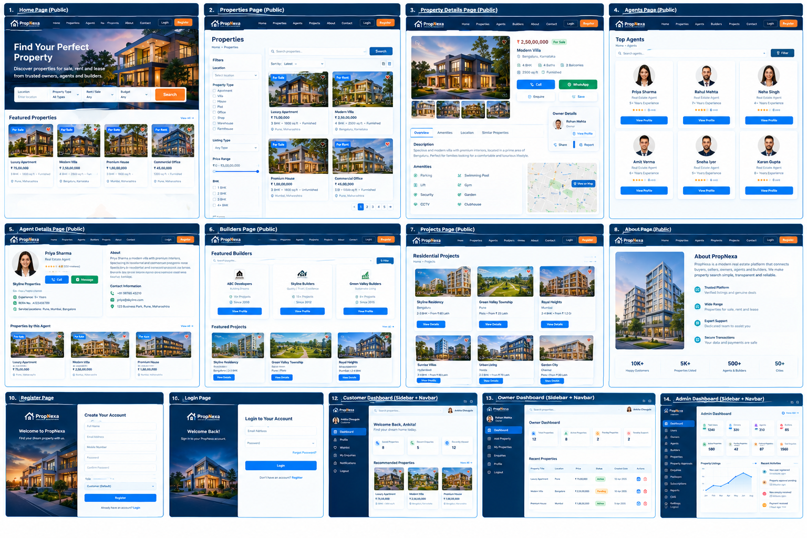

# Getting Started with Create React App

This project was bootstrapped with [Create React App](https://github.com/facebook/create-react-app).

## Available Scripts

In the project directory, you can run:

### `npm start`

Runs the app in the development mode.\
Open [http://localhost:3000](http://localhost:3000) to view it in your browser.

The page will reload when you make changes.\
You may also see any lint errors in the console.

### `npm test`

Launches the test runner in the interactive watch mode.\
See the section about [running tests](https://facebook.github.io/create-react-app/docs/running-tests) for more information.

### `npm run build`

Builds the app for production to the `build` folder.\
It correctly bundles React in production mode and optimizes the build for the best performance.

The build is minified and the filenames include the hashes.\
Your app is ready to be deployed!

See the section about [deployment](https://facebook.github.io/create-react-app/docs/deployment) for more information.

### `npm run eject`

**Note: this is a one-way operation. Once you `eject`, you can't go back!**

If you aren't satisfied with the build tool and configuration choices, you can `eject` at any time. This command will remove the single build dependency from your project.

Instead, it will copy all the configuration files and the transitive dependencies (webpack, Babel, ESLint, etc) right into your project so you have full control over them. All of the commands except `eject` will still work, but they will point to the copied scripts so you can tweak them. At this point you're on your own.

You don't have to ever use `eject`. The curated feature set is suitable for small and middle deployments, and you shouldn't feel obligated to use this feature. However we understand that this tool wouldn't be useful if you couldn't customize it when you are ready for it.

## Learn More

You can learn more in the [Create React App documentation](https://facebook.github.io/create-react-app/docs/getting-started).

To learn React, check out the [React documentation](https://reactjs.org/).

### Code Splitting

This section has moved here: [https://facebook.github.io/create-react-app/docs/code-splitting](https://facebook.github.io/create-react-app/docs/code-splitting)

### Analyzing the Bundle Size

This section has moved here: [https://facebook.github.io/create-react-app/docs/analyzing-the-bundle-size](https://facebook.github.io/create-react-app/docs/analyzing-the-bundle-size)

### Making a Progressive Web App

This section has moved here: [https://facebook.github.io/create-react-app/docs/making-a-progressive-web-app](https://facebook.github.io/create-react-app/docs/making-a-progressive-web-app)

### Advanced Configuration

This section has moved here: [https://facebook.github.io/create-react-app/docs/advanced-configuration](https://facebook.github.io/create-react-app/docs/advanced-configuration)

### Deployment

This section has moved here: [https://facebook.github.io/create-react-app/docs/deployment](https://facebook.github.io/create-react-app/docs/deployment)

### `npm run build` fails to minify

This section has moved here: [https://facebook.github.io/create-react-app/docs/troubleshooting#npm-run-build-fails-to-minify](https://facebook.github.io/create-react-app/docs/troubleshooting#npm-run-build-fails-to-minify)

===============Authentication(register+ login)============================

register=== bcrypt
login=== jwt token generation 
middleware==authentication + authorization
(authmiddlaware + rolemiddleware)

                         USER CREATE
                              │
                              ↓
                    Registration Form
                              │
                              ↓
                   POST /auth/register
                              │
                              ↓
                     AuthController
                              │
                    ┌─────────┴─────────┐
                    ↓                   ↓
              Validate Data       Check Existing
                    │              Email / Mobile
                    └─────────┬─────────┘
                              ↓
                       Hash Password
                         🔐 bcrypt
                              │
                              ↓
                         User Model
                              │
                              ↓
                           MongoDB
                              │
                              ↓
                     User Created ✅
                              │
                              ↓
                  Registration Response

                Property
                   │
       ┌───────────┼───────────┐
       ↓           ↓           ↓
    CREATE        READ       UPDATE
      POST         GET         PUT
       │           │           │
       └───────────┼───────────┘
                   ↓
                MongoDB
                   ↑
                   │
                DELETE
                 DELETE

                    USER                                                               
                     │
          ┌──────────┴──────────┐
          ↓                     ↓
   AUTHENTICATION          USER MANAGEMENT
          │                     │
          ↓                     ↓
 AuthController          UserController
          │                     │
    ┌─────┼─────┐        ┌─────┼─────┐
    ↓     ↓     ↓        ↓     ↓     ↓
 Register Login Profile  Get   Update Delete
                        Users   User   User

                        USER MODULE
                              │
              ┌───────────────┼───────────────┐
              ↓               ↓               ↓
           CREATE            READ           UPDATE
              │               │               │
      /auth/register      /users          /users/:id
              │               │               │
              │          /users/:id             │
              │               │               │
              └───────────────┼───────────────┘
                              ↓
                           DELETE
                              │
                         /users/:id
                              ↓
                           MongoDB

                          

                        PROP NEXA
                            │
          ┌─────────────────┼─────────────────┐
          ↓                 ↓                 ↓
     PUBLIC WEBSITE       AUTH            DASHBOARDS
          │                 │                 │
          │                 │       ┌─────────┼─────────┐
          │                 │       ↓         ↓         ↓
       Navbar            Navbar   Customer   Owner     Admin
          │                         │         │         │
          ↓                         ↓         ↓         ↓
    Anyone can view             Sidebar +  Sidebar + Sidebar +
    properties                   Navbar    Navbar    Navbar

=======================FRONTEND=============================

==========Customer Dashboard==========
┌─────────────────────────────────────────┐
│ PropNexa Navbar                         │
├──────────────┬──────────────────────────┤
│ SIDEBAR      │                          │
│              │     Dashboard            │
│ Dashboard    │                          │
│ Profile      │     Recommended          │
│ Wishlist     │     Properties           │
│ My Enquiries │                          │
│ Notifications│                          │
│ Logout       │                          │
└──────────────┴──────────────────────────┘
Search property
      ↓
View property
      ↓
Save to Wishlist
      ↓
Send Enquiry
      ↓
Track Enquiry

========================Owner Dashboard=======================
┌─────────────────────────────────────────┐
│              PropNexa Navbar            │
├──────────────┬──────────────────────────┤
│ SIDEBAR      │                          │
│              │       Dashboard          │
│ Dashboard    │                          │
│ My Properties│                          │
│ Add Property │                          │
│ Edit Property│                          │
│ Enquiries    │                          │
│ Profile      │                          │
│ Logout       │                          │
└──────────────┴──────────────────────────┘
Owner
 │
 ├── Dashboard
 ├── My Properties
 ├── Add Property
 ├── Edit Property
 ├── Enquiries
 ├── Profile
 └── Logout

 Owner Login
    ↓
Owner Dashboard
    ↓
Add Property
    ↓
POST /properties
    ↓
PropertyController
    ↓
Property.js
    ↓
MongoDB
    ↓
status = Pending

Pending
   ↓
Admin Approval
   ↓
Active
   ↓
Public Website

====================Agent Dashboard======================
┌─────────────────────────────────────────┐
│              PropNexa Navbar            │
├──────────────┬──────────────────────────┤
│ SIDEBAR      │                          │
│              │       Dashboard          │
│ Dashboard    │                          │
│ Agent Profile│                          │
│ Add Property │                          │
│ My Properties│                          │
│ Edit Property│                          │
│ Leads        │                          │
│ Logout       │                          │
└──────────────┴──────────────────────────┘
Agent Dashboard
 │
 ├── Dashboard
 ├── Agent Profile
 ├── Add Property
 ├── My Properties
 ├── Edit Property
 ├── Leads
 └── Logout

 ==================Builder Dashboard===================
 ┌─────────────────────────────────────────┐
│              PropNexa Navbar            │
├──────────────┬──────────────────────────┤
│ SIDEBAR      │                          │
│              │       Dashboard          │
│ Dashboard    │                          │
│ Builder      │                          │
│ Profile      │                          │
│ Add Project  │                          │
│ Projects     │                          │
│ Edit Project │                          │
│ Properties   │                          │
│ Enquiries    │                          │
│ Logout       │                          │
└──────────────┴──────────────────────────┘
 Builder Dashboard
 │
 ├── Dashboard
 ├── Builder Profile
 ├── Add Project
 ├── Projects
 ├── Edit Project
 ├── Properties
 ├── Enquiries
 └── Logout

 ====================Admin Dashboard====================

 ┌─────────────────────────────────────────┐
│              PropNexa Navbar            │
├────────────────┬────────────────────────┤
│ ADMIN SIDEBAR  │                        │
│                │      Dashboard         │
│ Dashboard      │                        │
│ Users          │                        │
│ Owners         │                        │
│ Agents         │                        │
│ Builders       │                        │
│ Properties     │                        │
│ Approvals      │                        │
│ Enquiries      │                        │
│ Packages       │                        │
│ Subscriptions  │                        │
│ Featured       │                        │
│ Reviews        │                        │
│ Advertisements │                        │
│ Reports        │                        │
│ CMS            │                        │
│ Notifications  │                        │
│ Settings       │                        │
└────────────────┴────────────────────────┘
 Admin Dashboard
 │
 ├── Dashboard
 ├── Users
 ├── Owners
 ├── Agents
 ├── Builders
 ├── Properties
 ├── Property Approvals
 ├── Enquiries
 ├── Packages
 ├── Subscriptions
 ├── Featured Properties
 ├── Reviews
 ├── Advertisements
 ├── Reports
 ├── CMS
 ├── Notifications
 └── Settings
'

FETCHING THE PENDING PROPERTIES------------

 Owner
  ↓
POST /properties
  ↓
Property created
  ↓
status = Pending
  ↓
Admin
  ↓
GET /properties/admin/pending
  ↓
Pending properties fetched ✅

| API                                 | Token required            |
| ----------------------------------- | ------------------------- |
| `POST /properties`                  | Owner/Agent/Builder token |
| `GET /properties/admin/pending`     | Admin token          |
| `PUT /properties/admin/approve/:id` | Admin token           |
| `PUT /properties/admin/reject/:id`  | Admin token           |

                    PROP NEXA
                       │
       ┌───────────────┼────────────────┐
       │               │                │
       ↓               ↓                ↓
   Customer        Provider           Admin
                  Owner/Agent/
                    Builder
       │               │                │
       │               ↓                │
       │        Create Property         │
       │               │                │
       │               ↓                │
       │           PENDING              │
       │               │                │
       │               └──────────────→ │
       │                            Review
       │                                │
       │                     ┌──────────┴─────────┐
       │                     ↓                    ↓
       │                  APPROVE              REJECT
       │                     ↓                    ↓
       │                  ACTIVE              REJECTED
       │                     │
       └─────────────────────┘
                  │
                  ↓
           Public Properties
                  │
                  ↓
           Property Details

Customer Enquiry / Contact Owner:======================

Customer
   ↓
View Property Details
   ↓
"Send Enquiry"
   ↓
Enquiry Model
   ↓
Enquiry Controller
   ↓
MongoDB
   ↓
Owner/Admin receives lead

Requirement
   ↓
Enquiry Model
   ↓
Enquiry Controller
   ↓
Enquiry Routes
   ↓
Postman Testing
   ↓
Property Details "Send Enquiry"
   ↓
MongoDB
   ↓
Owner/Admin Lead Management

Enquiry
├── property   → Which property?
├── customer   → Who sent the enquiry?
├── message    → What does the customer want?
├── status     → Lead progress
├── createdAt
└── updatedAt

Customer
   +
Property
   ↓
Enquiry
   ↓
Lead

Customer
   ↓
Send Enquiry
   ↓
MongoDB
   ↓
        Owner/Admin
           ↓
    View Enquiries
           ↓
      Lead Management
           ↓
 New → Contacted → Follow up → Converted → Closed

 Customer
   ↓
Send Enquiry
   ↓
MongoDB
   ↓
Provider Enquiries
   ↓
Change Status
   ↓
Contacted

Perfect 👍 Enquiry Management is now complete. Backend + frontend flow is connected.....................

Create “My Properties” for Provider========================

Owner Login
    ↓
JWT Token
    ↓
POST /properties
    ↓
Property Create
    ↓
owner = logged-in user's ID
    ↓
status = Pending
    ↓
GET /properties/my
    ↓
count: 1
properties: [...]

Step 1 — Create Property

Postman mein:

Method:

POST

URL:

http://localhost:9000/properties

Headers:

Authorization    Bearer YOUR_OWNER_TOKEN
Content-Type     application/json

Body → raw → JSON:

{
  "title": "2 BHK Apartment in Belagavi",
  "propertyType": "Apartment",
  "listingType": "Sell",
  "description": "Spacious 2 BHK apartment with modern facilities.",
  "state": "Karnataka",
  "district": "Belagavi",
  "city": "Belagavi",
  "area": "Tilakwadi",
  "landmark": "Near Main Road",
  "address": "Tilakwadi, Belagavi",
  "bhk": 2,
  "bedrooms": 2,
  "bathrooms": 2,
  "balconies": 1,
  "floor": 3,
  "totalFloors": 5,
  "furnishing": "Semi-Furnished",
  "builtUpArea": 1200,
  "carpetArea": 1000,
  "areaUnit": "sq.ft",
  "expectedPrice": 4500000,
  "negotiable": true,
  "amenities": [
    "Parking",
    "Lift",
    "Security",
    "Power Backup"
  ]
}

⚠️ owner aur status body mein mat bhejna. Backend automatically:

owner: req.user.id
status: "Pending"

set karega.

Step 2 — Phir GET My Properties
GET http://localhost:9000/properties/my

Same owner token ke saath.

Ab response approximately:

{
  "success": true,
  "count": 1,
  "properties": [
    {
      "_id": "...",
      "title": "2 BHK Apartment in Belagavi",
      "propertyType": "Apartment",
      "listingType": "Sell",
      "status": "Pending",
      "owner": "..."
    }
  ]
}

Customer
   ↓
View Active Property
   ↓
Send Enquiry
   ↓
POST /enquiries
   ↓
Enquiry saved
   ↓
Property Owner / Agent / Builder
   ↓
GET /enquiries
   ↓
See customer enquiry
   ↓
Update status
   ↓
New → Contacted → Follow up → Converted / Closed

Create Wishlist.js=======================

What this model means

Basically, Wishlist stores a relationship:

Customer
   │
   │ saves
   ↓
Property

What we have created

Three operations:

POST   /wishlist
       ↓
Add Property ❤️
GET    /wishlist
       ↓
View My Wishlist ❤️
DELETE /wishlist/:id
       ↓
Remove Property ❤️

Your Wishlist API will now be=====================================
Method	Endpoint	       Who
POST	  /wishlist	      Customer
GET	  /wishlist	      Customer
DELETE  /wishlist/:id	Customer

Builder Login
     ↓
JWT
     ↓
POST /builders
     ↓
AuthMiddleware
     ↓
RoleMiddleware
     ↓
BuilderController
     ↓
Builder Model
     ↓
MongoDB

builder verification through the admin=====================

Admin
  ↓
PUT /builders/admin/verify/:id
  ↓
AuthMiddleware
  ↓
RoleMiddleware(["admin"])
  ↓
Find Builder
  ↓
verificationStatus = "Verified"
  ↓
MongoDB

Builder
   ↓
Create Profile
   ↓
Pending
   ↓
        Admin
          ↓
PUT /builders/admin/verify/:id
          ↓
       Verified
          ↓
GET /builders
          ↓
Public Builder List

                 BUILDER DATA
                      │
             ┌────────┴────────┐
             ↓                 ↓
        PUBLIC SIDE        ADMIN SIDE
             │                 │
       /builders        /admin/builders
             │                 │
      "Show me builders"  "Manage builders"
             │                 │
       Verified only       All statuses

Navbar
   ↓
/agents
   ↓
GET /agent-profiles/approved
   ↓
Agent Cards
   ↓
View Details
   ↓
/agents/:id
   ↓
AgentDetails.jsx
   ↓
GET /agent-profiles/:id
   ↓
MongoDB
   ↓
Agent Details

Agent User
   ↓
Register/Login
   ↓
Role = "agent"
   ↓
Agent creates Agent Profile
   ↓
AgentProfile Model
   ↓
status = Pending
   ↓
Admin AgentManagement.jsx
   ↓
Admin sees all agents
   ↓
Approve / Reject
   ↓
Approved
   ↓
Public Agents.jsx
   ↓
GET /agent-profiles/approved
   ↓
Verified Agents cards
   ↓
User clicks "View Details"
   ↓
AgentDetails.jsx
   ↓
GET /agent-profiles/:id
   ↓
Agent's complete details

[======================Agent/Builder → Profile → Admin Verification → Public Listing → Details Page=========================]

POST   /owner-profiles
        ↓
Create Owner Profile

GET    /owner-profiles/my
        ↓
Owner sees own profile

PUT    /owner-profiles/my
        ↓
Owner edits own profile

GET    /owner-profiles/admin/all
        ↓
Admin sees all owners

PUT    /owner-profiles/admin/verify/:id
        ↓
Admin verifies owner

PUT    /owner-profiles/admin/reject/:id
        ↓
Admin rejects owner

Owner Login
   ↓
Owner Dashboard
   ├── My Properties
   │     ├── Add Property
   │     ├── View
   │     ├── Edit
   │     └── Delete
   │
   ├── My Profile  ← NEXT
   │
   └── Enquiries

   Customer Dashboard
│
├── Browse Properties
├── My Wishlist
├── My Enquiries
├── My Profile
└── Logout

Customer Dashboard
       │
       ├── Browse Properties
       │
       ├── My Wishlist
       │
       ├── My Enquiries
       │
       └── My Profile
              ↓
        GET /auth/profile
              ↓
            User

Owner Login
    ↓
Owner Dashboard ✅
    ↓
Add Property
    ↓
Fill Property Form
    ↓
Create Property
    ↓
Backend POST /properties
    ↓
MongoDB
    ↓
Property status = Pending
    ↓
My Properties

Agent Dashboard
│
├── Welcome Agent
│
├── Statistics
│   ├── My Properties
│   ├── Active Properties
│   ├── Pending Properties
│   └── Enquiries
│
├── Quick Actions
│   ├── Add Property
│   ├── My Properties
│   ├── My Enquiries
│   └── My Profile
│
└── My Recent Properties
    ├── Banner Image
    ├── Property Title
    ├── Location
    ├── Price
    └── Status